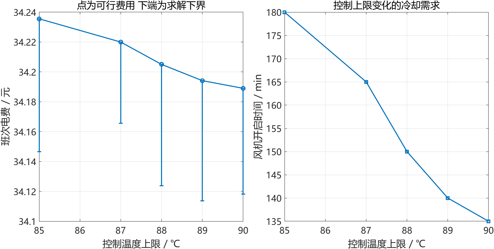

# AI 辅助工业电机数学建模

使用 MATLAB 研究工业电机在分时电价、订单交付和温度约束下的运行调度。项目包含参数辨识、混合整数优化、鲁棒性分析及一篇完整中文论文，并记录 AI 辅助完成与核验工作的过程。

**这是基于教学模拟数据的建模案例，不是实机试验或已发表论文。代码、计算和论文制作由 AI 代理大量参与，具体分工见 [AI 使用说明](docs/AI_USAGE.md)。**

## 从这里开始

- [修订论文 Word 版](paper/工业电机数学建模完整论文_修订版.docx)：23页，26个公式、18张表、6幅图。
- [在线阅读论文](paper/完整数学建模论文_修订版_含运行表.md)
- [AI 辅助研究过程与贡献边界](docs/AI_USAGE.md)
- [复现步骤与结果核验](docs/REPRODUCIBILITY.md)
- [5分钟展示提纲与自主学习任务](docs/DEMO.md)

## 研究问题

对一台15 kW变频电机，联合决定生产转速、电机启停与冷却风机状态，在8小时内完成5000件及阶段交付要求，使分时电费最低，同时不超过90 ℃温度上限。

1. 用15组模拟转速—转矩—损耗数据拟合损耗响应面。
2. 用模拟加热、冷却试验识别一阶热阻和热容量。
3. 用解析温度递推和混合整数线性规划优化调度。
4. 分析环境、负载、订单扰动，以及温度裕量和控制网格的影响。

## 主要实算结果

以下均是给定模型的数值结果，不代表实机节能承诺。

| 方案 | 电费 元/班 | 电量 kWh | 最高温度 ℃ |
|---|---:|---:|---:|
| 固定1250 r/min 全班开启风机 | 40.1815 | 53.5473 | 66.0750 |
| 5 min、50 r/min名义联合调度 | 34.1890 | 52.1756 | 89.9470 |
| 88 ℃控制上限候选计划 | 34.2051 | 52.2066 | 87.9377 |

名义方案相对上述固定基准节费14.914%、节电2.562%。将计划温度上限设为88 ℃，本次可行计划仅增加约0.016元/班；该差额不是已证明的最优费用增量，88 ℃也不是经过实机校准的安全阈值。



补充实验将单独优化风机、单独优化生产调度及联合优化分开比较，并报告求解上下界。一般实验限时60秒；同一名义问题延长至180秒后，可行费用不变，相对最优间隙从约0.207%缩小至0.075%。

## 运行

已验证环境：MATLAB R2024a、Optimization Toolbox 24.1。下载仓库并将 MATLAB 当前文件夹切换到仓库根目录。

```matlab
% 先核验仓库已有的基础结果，不重新优化
verification = verify_motor_results;

% 重算基础实验及论文前四幅图
results = run_motor_modeling;
paper_figures;

% 重算12套补充计划及后两幅图
experiments = run_revision_experiments;
```

完整计算可能需要十余分钟至数十分钟。整数求解设有时间上限，不同机器可能返回不同近优计划；请同时比较交付、温度、费用与最优间隙。重算会更新结果文件，但不会自动更新已保存的Word论文。

## 文件结构

| 路径 | 内容 |
|---|---|
| `run_motor_modeling.m` | 基础模型、拟合、9次调度及27组鲁棒回放 |
| `run_revision_experiments.m` | 12套补充计划及独立核验 |
| `verify_motor_results.m` | 基础计划的ODE、交期与持续时间核验 |
| `paper_figures.m` | 模型比较、能量分项与中文图表 |
| `results/` | 基础实验快照、CSV运行表与MAT数据 |
| `revision_results/` | 温度裕量、对照、网格及预算实验 |
| `paper/` | 修订论文、图表及附件说明 |
| `docs/` | AI使用记录、复现说明与展示提纲 |

## 适用范围

温度模型为单节点近似；鲁棒分析没有覆盖热阻、热容量和测温偏差。生产率与转矩关系采用题设假设，未验证不同转速下的加工质量。经济目标不含人工加班、设备投资及开关寿命成本。独立ODE积分核验验证的是程序实现，不是实机预测精度。

本仓库未设置开源许可证；公开可见不等同于授予任意再分发许可。MATLAB及工具箱需要使用者自行获得合法授权。
