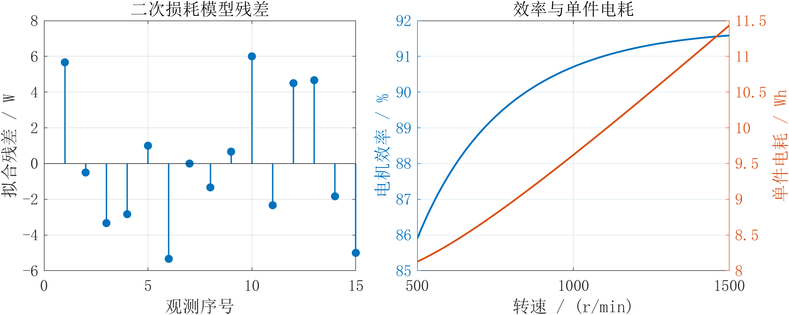
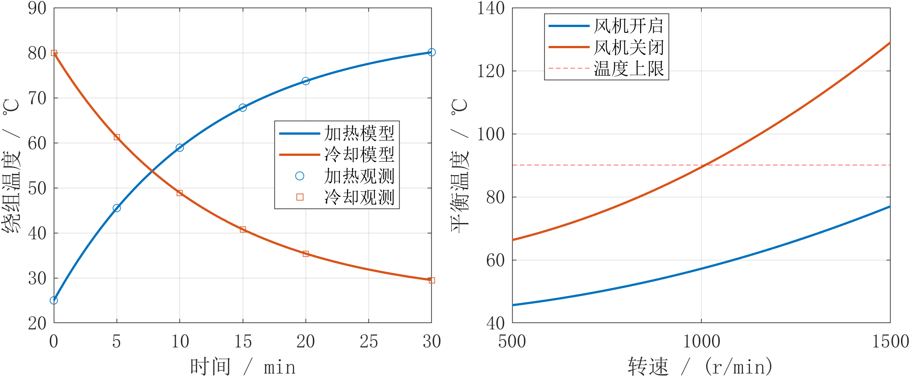
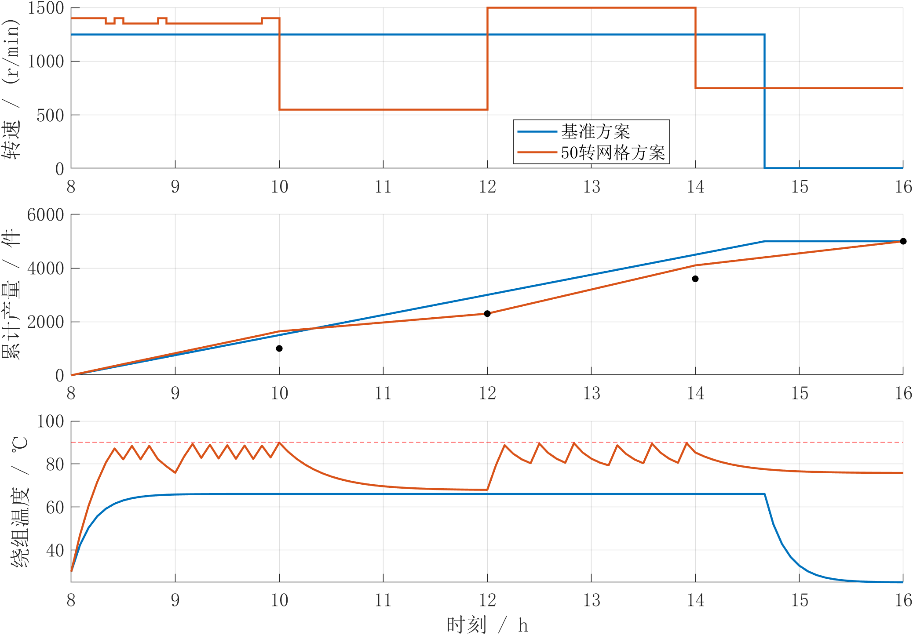
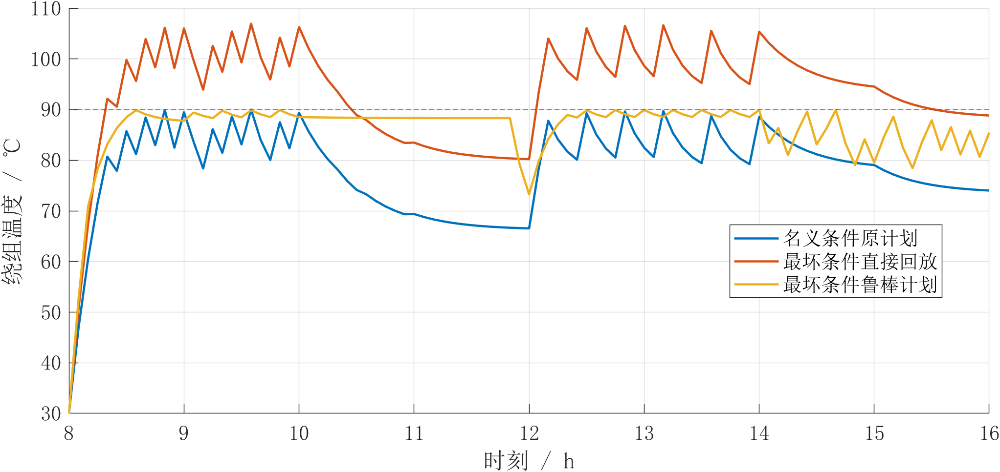
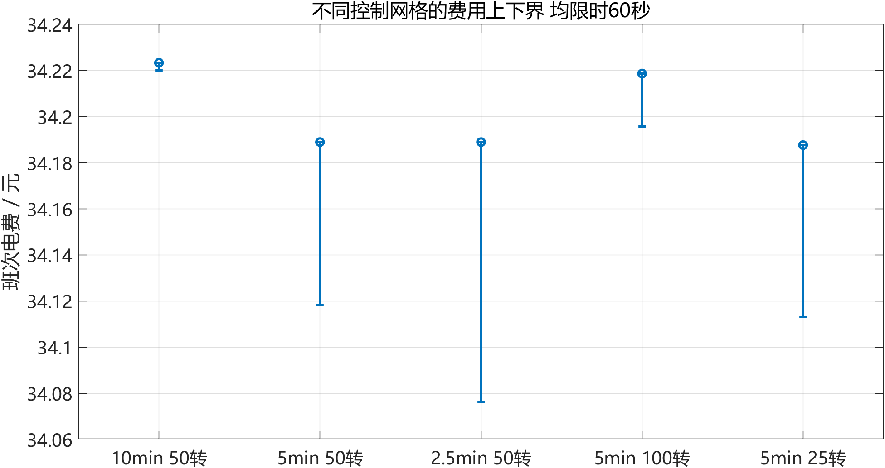

# 考虑温度约束与分时电价的工业电机生产调度优化

## 摘要

针对工业电机在分时电价、阶段交付和温度约束下的生产调度问题，本文建立损耗响应面、一阶热模型与混合整数线性规划，并使用MATLAB完成参数识别、调度优化和补充对照实验。全部输入来自题设模拟数据，结果用于建模训练与试验方案设计。

损耗模型比较表明，完整二次响应面的拟合与留一RMSE分别为3.61 W和7.28 W。500 r/min对应最低单件电耗8.13 Wh，但8小时产量仅2400件，无法满足订单。联合加热与冷却数据识别热阻约0.06004 K/W、热容量约12003 J/K；25 ℃环境下，风机开启时全部允许转速可长期运行，关闭时长期安全转速临界值约1009 r/min。

采用5 min控制区间、解析热递推和启停约束，50 r/min网格方案完成5000件，电费34.19元、耗电52.18 kWh，较固定转速全班风机基准分别下降14.91%和2.56%，离散模型最优间隙为0.2115%。能量分项与控制方式对照表明，节费主要来自生产时段调整，风机控制提供额外收益。

针对接近90 ℃温度上限的问题，补充85～90 ℃控制上限实验。88 ℃方案电费34.21元，比补充实验90 ℃可行方案增加0.02元，计划最高温度87.94 ℃。同时比较2.5、5、10 min时间网格与25、50、100 r/min转速网格，报告求解上下界，并以60 s和180 s预算区分控制离散与求解误差。温度余量是计划指标，不能替代实机误差校准。

在环境、负载及损耗扰动下，利用热系统单调性构造5500件鲁棒计划，27组参数回放均合格。延时生产与升级风机仅在明确交期后比较。本文区分数据拟合、数值实现核验与工程验证，给出可复现程序及完整运行表，并说明热参数不确定性与设备寿命成本尚未覆盖。

关键词：工业电机；参数辨识；温度裕量；混合整数线性规划；鲁棒调度；MATLAB

<!-- PAGEBREAK -->

## 一 问题重述

### 研究对象与决策目标

某工厂使用一台15 kW变频电机驱动连续加工设备，电机运行转速为500～1500 r/min，也可以停机。负载转矩和单位时间产量随转速变化，工厂需要在08:00至16:00完成5000件产品，并满足四个时点的阶段交付要求。电价随时段变化，电机还受到绕组温度上限和最短启停时间约束。

传统方案以1250 r/min连续生产，风机在整个班次保持开启，完成订单后停止电机。该方案便于执行，却没有利用电价差异，也没有依据温度变化控制冷却。本文研究如何在保持交付与温度安全的条件下调整转速、启停及风机状态，使班次电费最低。

### 四项研究任务

第一项任务是利用转速—转矩—损耗试验建立损耗模型，评价模型误差，并分析电机效率与单位产品电耗。第二项任务是利用加热和冷却试验识别热参数，判断不同转速与冷却状态下的连续运行能力。第三项任务是联立能耗、温度、交付和启停约束，制定低电费生产计划并与基准比较。第四项任务是考察环境温度、负载和订单扰动，构造鲁棒计划，并比较延时生产和升级风机的作用。

在第四项任务中，原题没有单独规定延时后的交付口径。本文明确区分两类服务承诺：标准方案要求全部订单16:00前完成；延时方案仅允许追加的500件在16:30前交付，原有5000件仍须在16:00前完成。若追加订单同样必须在16:00交付，则延时生产不能用于弥补该时点的产量缺口。

## 二 数据整理与问题分析

### 运行关系与损耗试验

设转速为n，题设给出负载转矩T_L与生产率q：

$$T_L(n)=30+0.02n,\qquad q(n)=0.01n. \tag{1}$$

其中n的单位为r/min，T_L的单位为N·m，q的单位为件/min。轴端输出机械功率由旋转运动功率关系确定：

$$P_{out}(n)=\frac{2\pi nT_L(n)}{60}. \tag{2}$$

电机损耗是输入电功率与轴端输出功率之差，不含外置冷却风机功率。题设15组模拟损耗数据如表1所示，题目另给出相对测量误差一般不超过3%的条件。该误差条件不是实测校准报告，也不是本文从数据估计出的置信限。

表1 电机损耗试验数据

| 转速 r/min | 转矩30 N·m时损耗 W | 转矩60 N·m时损耗 W | 转矩90 N·m时损耗 W |
|---|---:|---:|---:|
| 500 | 300 | 470 | 760 |
| 750 | 350 | 530 | 840 |
| 1000 | 420 | 620 | 950 |
| 1250 | 510 | 730 | 1090 |
| 1500 | 620 | 860 | 1250 |

### 热试验与生产条件

两组模拟热试验的环境温度均为25 ℃、风机均开启。加热试验初温25 ℃，施加1000 W等效热功率；冷却试验初温80 ℃，热功率为零。观测温度见表2。正常生产初温为30 ℃，绕组温度上限为90 ℃。

表2 加热与冷却试验数据

| 时间 min | 加热温度 ℃ | 冷却温度 ℃ |
|---|---:|---:|
| 0 | 25.0 | 80.0 |
| 5 | 45.5 | 61.3 |
| 10 | 58.9 | 48.9 |
| 15 | 67.8 | 40.8 |
| 20 | 73.7 | 35.4 |
| 30 | 80.1 | 29.5 |

原风机功率为120 W。关闭风机时等效热阻增为开启时的2倍，热容量不变；电机停止后仍可开启风机。每次启动额外消耗0.03 kWh，不计入绕组温升。电机每次连续运行和停机均不少于10 min，班次结束后的停机时长除外；风机每次连续开、关均不少于5 min。

表3 分时电价与阶段交付要求

| 时段 | 电价 元/kWh | 时段末累计交付要求 件 |
|---|---:|---:|
| 08:00—10:00 | 0.65 | 1000 |
| 10:00—12:00 | 1.10 | 2300 |
| 12:00—14:00 | 0.45 | 3600 |
| 14:00—16:00 | 0.90 | 5000 |

允许提前生产和暂存，不考虑库存成本。累计产量按连续量计算，最终交付数量向下取整。本次计算的最终产量恰为5000或5500件，阶段产量均满足下界，不存在依赖非整数最终产量过关的情况。

### 模型之间的联系

损耗模型同时提供电功率与发热功率，是能耗和温度计算的连接环节。热模型将既往运行状态转换为当前可用温度裕量；电价和交付要求则决定何时提前生产、何时降低转速。因此，不能仅依据某一个转速的效率排序来选择班次计划。

电机热行为可用集总参数热网络描述[1]。考虑热约束的电驱系统优化研究也表明，热状态应与运行决策共同建模[2]。本文针对题目数据规模采用单节点热模型，并将可选择工况离散，使联合调度可转化为能报告最优性界限的混合整数线性规划。

## 三 模型假设

1. 在每个控制区间内，转速、负载转矩、环境温度和风机状态恒定；忽略题设允许忽略的调速时间及调速能耗。
2. 生产率只由转速决定。负载扰动不改变每转加工件数，生产速度变化不引起额外废品或质量差异。
3. 电机损耗全部进入所建热系统；停机时电机损耗为零。没有题设依据的变频器待机功率不另行添加。
4. 绕组温度用单一集总状态表示，热阻和热容量在研究范围内保持常数。风机关闭时的自然散热热阻为原开启热阻的2倍。
5. 启动电能计入启动时段的电费，不计入温升。启停冲击以启动次数统计，题设未给冲击货币成本，因此不将其折算成虚构费用。
6. 班次开始前电机已停机足够长，不存在继承自上一班次的停机时长约束；风机可在08:00选择初始状态。
7. 升级风机只改变开启时的散热热阻，关闭状态的自然散热热阻仍为原值。设备购置、维护和人工加班费用不计入电费目标。
8. 不确定性研究中热参数保持识别值不变；损耗±3%另作为附加模型扰动假设，并非由小样本试验估计出的统计置信区间。

## 四 符号说明

表4 主要符号及单位

| 符号 | 含义 | 单位或取值 |
|---|---|---|
| n，T_L | 转速与负载转矩 | r/min，N·m |
| L | 电机损耗及热功率 | W |
| P_out，P_in | 机械输出与电机输入功率 | W |
| θ，θ_a | 绕组温度与环境温度 | ℃ |
| R，C | 风机开启热阻与等效热容量 | K/W，J/K |
| Δt，N | 控制间隔与区间数量 | min，个 |
| z_kj | 区间k选择转速j的指示变量 | 0或1 |
| u_k，f_k | 电机运行与风机开启指示变量 | 0或1 |
| s_k，d_k | 电机启动与停止指示变量 | 0或1 |
| Q_k，D_i | 累计产量与交付要求 | 件 |
| p_k，J | 电价与班次总电费 | 元/kWh，元 |
| λ，ρ | 转矩倍率与损耗倍率 | 无量纲 |
| U，B，g | 可行费用上界 最优下界 相对间隙 | 元，元，无量纲 |

## 五 损耗与能效模型

### 模型选择与最小二乘识别

令x=n/1000、y=T_L/60，消除原始自变量量级差异。考虑一次项、二次项以及速度与转矩的交互作用，建立响应面：

$$L(n,T_L)=\beta_0+\beta_1x+\beta_2y+\beta_3x^2+\beta_4xy+\beta_5y^2. \tag{3}$$

将15个观测写成设计矩阵X与损耗向量l，求解线性最小二乘问题：

$$\hat{\beta}=\arg\min_{\beta}\|X\beta-l\|_2^2. \tag{4}$$

程序使用MATLAB左除运算X\l求解，不显式求逆。模型参数识别为：

$$\hat{\beta}=(306,-144,-170,186.666667,172,268)^T. \tag{5}$$

这些系数构成经验响应面，不能将每一项直接解释成独立的铜耗、铁耗或机械损耗。选择模型的依据包括误差、交叉验证表现与工况范围内的合理性，而不只看训练决定系数。

本文进一步比较三种候选形式。线性模型采用1、x、y三项；无交互二次模型增加x²和y²；完整二次模型再加入xy。留一验证每次删除一个观测，用剩余数据重新识别并预测被删除点。结果如表5。

表5 候选损耗模型的误差比较

| 模型 | 参数个数 | 拟合RMSE W | 留一RMSE W | 最大相对拟合误差 % |
|---|---:|---:|---:|---:|
| 线性模型 | 3 | 44.8107 | 58.0886 | 27.6667 |
| 无交互二次模型 | 5 | 25.0865 | 41.8778 | 12.4444 |
| 完整二次模型 | 6 | 3.6056 | 7.2804 | 1.8889 |

完整二次模型的训练误差和留一误差均显著减小，最大相对拟合误差低于题设一般不超过3%的测量误差水平，决定系数为0.999815。留一误差仍高于训练误差，说明不能把训练精度直接当作所有未观测工况的预测保证。

### 适用范围与物理合理性

模型适用于500≤n≤1500 r/min、30≤T_L≤90 N·m的试验矩形。本题正常负载为40～60 N·m，±10%扰动后为36～66 N·m，均处于该矩形内。对归一化转矩的偏导为：

$$\frac{\partial L}{\partial y}=-170+172x+536y. \tag{6}$$

在x∈[0.5,1.5]、y∈[0.5,1.5]内，该偏导最小为184，大于零。对x的偏导为−144+373.333334x+172y，最小约128.667，也大于零。拟合损耗为正，且随转速、转矩单调增加。本题后续鲁棒性论证可利用这种单调性，但不得外推到堵转、超速或温度相关铜耗等未经试验的情形。

### 运行效率与单位产品电耗

代入负载关系后，损耗可展开为关于n的一元二次式：

$$L(n)=288-0.025333333n+0.000273777778n^2. \tag{7}$$

电机输入功率与效率为：

$$P_{in}=P_{out}+L,\qquad \eta=\frac{P_{out}}{P_{in}}. \tag{8}$$

将W转换为kW、将生产率的min转换为h，得到不含外置风机和启动的单件电耗：

$$e(n)=\frac{P_{in}(n)}{600n}\quad \mathrm{kWh/item}. \tag{9}$$

本题输入功率为288+3.11625932n+0.00236817288n²，因此：

$$e'(n)=\frac{0.00236817288-288/n^2}{600}>0. \tag{10}$$

不等式在500～1500 r/min成立，故最低单件电耗在500 r/min处，等于0.008127243 kWh/件，即8.1272 Wh/件。该结果由解析单调性得到，不依赖网格搜索是否足够细。



表6 代表性转速下的能效指标

| 转速 r/min | 转矩 N·m | 损耗 W | 电机效率 % | 单件电耗 Wh |
|---|---:|---:|---:|---:|
| 500 | 40 | 343.778 | 85.900 | 8.1272 |
| 750 | 45 | 423.000 | 89.311 | 8.7940 |
| 1000 | 50 | 536.444 | 90.707 | 9.6207 |
| 1250 | 55 | 684.111 | 91.322 | 10.5115 |
| 1500 | 60 | 866.000 | 91.585 | 11.4342 |

高速时效率更高，单件电耗却也更高，原因是负载转矩随转速提高，单位产品所需机械能随之变化。两项指标评价的对象不同。500 r/min只能生产5件/min，8小时共2400件；完成5000件所需平均生产率至少10.4167件/min。因此，单件电耗最低点不能直接作为可行的班次运行点。

## 六 温度预测与连续运行能力

### 一阶热平衡与解析解

采用单节点热平衡，进入热系统的损耗为L，向环境散出的功率为(θ−θ_a)/R_f。时间t以秒计，风机状态对应热阻R_f：

$$C\frac{d\theta}{dt}=L-\frac{\theta-\theta_a}{R_f}. \tag{11}$$

原风机开启时R_f=R，关闭时R_f=2R。该方程是集总热网络的简化形式[1]；单节点假设与题设数据量相匹配，但没有区分绕组、机壳和转子的独立温度。

当L和R_f恒定时，平衡温度及解析温度为：

$$\theta_{\infty}=\theta_a+R_fL. \tag{12}$$

$$\theta(t)=\theta_{\infty}+(\theta_0-\theta_{\infty})\exp\left(-\frac{t}{R_fC}\right). \tag{13}$$

### 加热与冷却试验联合识别

根据两组试验条件，加热预测为25+1000R[1−exp(−t/RC)]，冷却预测为25+55exp(−t/RC)。构造两组各6个温度残差，联合最小化残差平方和：

$$\min_{R>0,C>0}\sum_{i=1}^{6}\left[r_{h,i}(R,C)^2+r_{c,i}(R,C)^2\right]. \tag{14}$$

MATLAB的lsqnonlin要求输入残差向量，平方和由求解器形成[3]。程序设置初值R=0.06、C=12000，取正参数边界，得到R=0.0600413900 K/W、C=12002.5005 J/K，时间常数RC=720.6468 s，即12.0108 min。联合拟合RMSE为0.024045 ℃。

加热试验同时包含稳态温升和时间常数信息，冷却试验主要反映时间常数，两者联合有助于约束参数。此处采用各自试验的初温25 ℃、80 ℃，没有将生产班次初温30 ℃混入试验拟合。很小的拟合误差只表示模型能够解释题设模拟数据，不能当作真实电机的预测精度承诺。

### 连续运行判据与超温时间

正常初温为30 ℃。当θ_∞≤90 ℃时，温度始终不超过上限；当θ_∞>90 ℃时，由式（13）解出首次达到上限的时间：

$$t_{90}=-R_fC\ln\left(\frac{\theta_{\infty}-90}{\theta_{\infty}-30}\right). \tag{15}$$

该式的单位为秒，表7转换为min。当平衡温度恰为90 ℃时，系统只渐近趋近上限，有限时间不触及，t_90记为无穷大。若需实际温度裕量，应将判据中的90 ℃替换为更低的控制阈值。

表7 不同转速与冷却状态下的连续运行能力

| 转速 r/min | 开风机平衡温度 ℃ | 关风机平衡温度 ℃ | 关风机首次90℃ min | 关风机可长期运行 |
|---|---:|---:|---:|---|
| 500 | 45.641 | 66.282 | 不会达到 | 是 |
| 750 | 50.398 | 75.795 | 不会达到 | 是 |
| 1000 | 57.209 | 89.418 | 不会达到 | 是 |
| 1250 | 66.075 | 107.150 | 36.123 | 否 |
| 1500 | 76.996 | 128.992 | 22.381 | 否 |

风机开启时最高平衡温度为76.996 ℃，所以全部允许转速均可连续运行8小时，也可长期运行。风机关闭时，解25+2RL(n)=90，得到临界转速1009.2402 r/min；若按整数转速选择，则不高于1009 r/min满足长期温度限制。



## 七 满足交付要求的运行优化

### 控制离散与决策变量

取控制间隔Δt=5 min，标准班次共N=96段。主网格为500、600、…、1500 r/min，并额外加入1250 r/min，共12个运行转速；另以500、550、…、1500 r/min的21个转速组成细网格。停机状态通过u_k=0表示，不将零转速送入正常运行损耗关系。

设z_kj为第k段选择转速n_j的二进制变量，u_k为运行状态，则：

$$\sum_j z_{kj}=u_k,\qquad n_k=\sum_j n_jz_{kj}. \tag{16}$$

预先计算每个转速的损耗L_j与输入功率P_in,j，再将区间损耗和功率表示为z_kj的线性组合。所有可选正常工况都满足轴端输出功率不超过15000 W。

### 产量与阶段交付约束

累计产量满足：

$$Q_0=0,\qquad Q_k=Q_{k-1}+0.01n_k\Delta t. \tag{17}$$

对10:00、12:00、14:00、16:00对应的区间末索引24、48、72、96，约束：

$$Q_{24}\ge1000,\quad Q_{48}\ge2300,\quad Q_{72}\ge3600,\quad Q_{96}\ge5000. \tag{18}$$

采用下界而非等式，允许低价时段提前生产。由于目标中的能量成本为正，模型没有无成本无限超产的动机；本次求解的最终产量恰等于订单数量。

### 精确热递推与线性化

由解析解，令a_f=exp[−60Δt/(R_fC)]，区间递推为：

$$\theta_k=a_f\theta_{k-1}+(1-a_f)(\theta_a+R_fL_k). \tag{19}$$

该式在区间工况恒定时精确，不存在显式欧拉法的离散积分误差。分别计算风机开、关的预测温度F_1,k与F_0,k，以f_k选择对应方程：

$$-M(1-f_k)\le\theta_k-F_{1,k}\le M(1-f_k). \tag{20}$$

$$-Mf_k\le\theta_k-F_{0,k}\le Mf_k. \tag{21}$$

取M=200 ℃，覆盖本题所有有界温度及最大损耗下的递推残差。风机开启时式（20）退化为等式，风机关闭时式（21）退化为等式。两式的表达式均对决策变量线性，从而避免直接出现f_kθ_k或f_kL_k的乘积。

设置θ_0=30 ℃，所有区间边界温度不超过90 ℃。在恒定输入区间内，式（13）单调趋近平衡温度，区间内极值位于端点。因此边界温度约束能够保证整个控制区间安全，而不是仅保证采样瞬间安全。

### 启停与风机持续时间约束

令s_k和d_k为启动、停止指示，u_0=0，有：

$$u_k-u_{k-1}=s_k-d_k,\qquad s_k+d_k\le1. \tag{22}$$

最短10 min连续运行和停机分别转换为相邻两段约束：

$$u_k+u_{k+1}\ge2s_k,\qquad 2-u_k-u_{k+1}\ge2d_k. \tag{23}$$

式（23）用于k=1至N−1，另禁止最后一段新启动，以免班次内运行不足10 min。末段停止是允许的，符合班次结束后的停机时长豁免。风机只能在5 min边界切换，任意连续开、关状态至少持续一个区间，因此自动满足5 min最短持续时间。

### 电费目标与求解方法

风机功率为P_f=120 W，区间电能包含电机、风机以及启动能量：

$$E_k=\frac{\Delta t}{60000}\left(\sum_jP_{in,j}z_{kj}+P_ff_k\right)+0.03s_k. \tag{24}$$

$$\min J=\sum_{k=1}^{N}p_kE_k. \tag{25}$$

其中Δt以min计，60000来自W到kW和min到h的共同换算。启动电能已经给定为kWh，不再次乘运行时长，也不虚构为某个瞬时功率。

固定可选工况后，式（16）至（25）组成混合整数线性规划。本文使用MATLAB R2024a和Optimization Toolbox 24.1，以optimvar和optimproblem建模，再调用intlinprog的HiGHS算法。基础实验每个情景的求解时间上限为90 s，保留可行解、目标上下界和约束违反量。算法执行流程见附录B。

HiGHS相对间隙g=(U−B)/|U|，其中U为已知可行方案费用，B为最优费用下界[4]。基础实验各次调度均因时间上限返回整数可行解，退出标志为2，不能据此声称证明了精确最优。50 r/min方案间隙为0.2115%，保证针对其离散MILP，不是针对连续时间、连续转速原问题。

### 基准与名义优化结果

基准以1250 r/min从08:00连续运行到14:40，完成5000件后停机，风机仍开到16:00。四个交付时点的产量分别为1500、3000、4500、5000件，均合格。基准最高温度为66.0750 ℃。

表8 名义条件下的方案比较

| 指标 | 基准方案 | 100转网格方案 | 50转网格方案 |
|---|---:|---:|---:|
| 总电量 kWh | 53.5473 | 52.4066 | 52.1756 |
| 总电费 元 | 40.1815 | 34.2187 | 34.1890 |
| 最高温度 ℃ | 66.0750 | 89.9982 | 89.9470 |
| 最终产量 件 | 5000 | 5000 | 5000 |
| 启动次数 | 1 | 1 | 1 |
| 离散模型间隙 % | 不适用 | 0.1492 | 0.2115 |

相对基准，细网格方案每班节省5.9925元，节费14.914%，总电量减少1.3717 kWh，节电2.562%。其全部阶段交付要求满足，转速和风机逐段运行表列于附录A。两种网格的费用差仅0.0297元，约0.087%，小于各自的求解间隙量级，因此不能把这项差异全部解释成转速网格细化带来的确定收益。

表9 50转网格方案的分时段统计

| 时段 | 平均转速 r/min | 产量 件 | 累计产量 件 | 风机开启 min | 电费 元 |
|---|---:|---:|---:|---:|---:|
| 08:00—10:00 | 1366.667 | 1640 | 1640 | 50 | 11.7474 |
| 10:00—12:00 | 550.000 | 660 | 2300 | 0 | 5.9803 |
| 12:00—14:00 | 1500.000 | 1800 | 4100 | 85 | 9.3382 |
| 14:00—16:00 | 750.000 | 900 | 5000 | 0 | 7.1231 |

表9是统计汇总，平均转速不构成可直接替代附录A的可行控制表。尤其08:00—10:00存在转速和风机切换，若将平均值当作恒定工况，温度轨迹将发生变化。



### 节电与节费的来源

从电费结构看，基准10:00—12:00电费17.6079元，优化后为5.9803元，减少11.6276元；其他三个时段的费用合计增加5.6351元，净减少5.9925元。优化在高价时段降低转速，利用前后时段提前生产或完成剩余订单，电价转移效应是节费的主要来源。

表10 两方案的能量分项

| 能量分项 kWh | 基准方案 | 50转网格方案 | 优化后变化 |
|---|---:|---:|---:|
| 轴端机械输出 | 47.9966 | 47.0541 | −0.9425 |
| 电机内部损耗 | 4.5607 | 4.8215 | +0.2608 |
| 风机耗电 | 0.9600 | 0.2700 | −0.6900 |
| 启动耗电 | 0.0300 | 0.0300 | 0.0000 |
| 合计 | 53.5473 | 52.1756 | −1.3717 |

表10表明，调度并未减少所有能量分项。优化电机运行时间更长，内部损耗电量略增；但给定负载关系下机械输出电量减少，加上风机由全班开启改为累计135 min开启，最终总电量下降。这一解释依赖题设“相同产品可按给定生产率在不同转速下加工”的假设；若实际加工质量或每件所需机械工作量随速度产生额外约束，需要重新建立工艺模型。

## 八 不确定性分析与鲁棒决策

### 参数盒与联合最坏情景

设置环境温度θ_a∈[25,35] ℃、负载倍率λ∈[0.9,1.1]，负载为λ(30+0.02n)。追加订单情景的最终交付量为5500件，中间交付要求不变。另加入损耗倍率ρ∈[0.97,1.03]作为附加敏感性假设，即实际热功率为ρL(n,T_L)。

名义100转网格计划在35 ℃、负载增加10%、损耗增加3%的条件下直接回放，最高温度达到106.9520 ℃，最终仍只有5000件，温度和5500件交付要求均不合格。这说明名义电费方案没有自动提供对扰动的安全保证。

### 鲁棒约束的单调性论证

固定一组转速及风机计划，对比两个工况，假设工况2的环境温度和热功率均不小于工况1，初温相同。温度差δ满足：

$$\frac{d\delta}{dt}=-\frac{\delta}{R_fC}+\frac{\Delta\theta_a}{R_fC}+\frac{\Delta L}{C}. \tag{26}$$

由于Δθ_a≥0、ΔL≥0、δ(0)=0，该线性系统的响应δ(t)≥0。式（6）又保证研究范围内损耗随负载增加。因此，参数盒内温度上界由θ_a=35 ℃、λ=1.1、ρ=1.03给出。生产率对这些扰动不变，只需按最大订单5500件约束产量。

在固定电价下，电机输入功率也随负载、损耗倍率增加，故同一控制表的最坏电费发生在最大倍率。于是，可以在联合最坏工况下优化，得到对上述参数盒有效的鲁棒近优方案；该归结依赖热参数不变、损耗单调和生产率不受负载影响的假设。

本文另在环境温度25、30、35 ℃，负载倍率0.9、1、1.1，损耗倍率0.97、1、1.03的27种组合上回放验证。数值回放用于复核实现，参数盒内的覆盖性则由单调性说明，而非仅由有限样本推出。

### 单因素与联合扰动结果

表11 扰动条件下重新调度的结果

| 情景 | 最终产量 件 | 电费 元 | 电量 kWh | 最高温度 ℃ | 间隙 % |
|---|---:|---:|---:|---:|---:|
| 名义100转网格 | 5000 | 34.2187 | 52.4066 | 89.9982 | 0.1492 |
| 仅环境升至35 ℃ | 5000 | 34.2847 | 52.2956 | 89.7127 | 0.0222 |
| 仅负载增加10% | 5000 | 37.5696 | 57.4237 | 89.9560 | 0.2452 |
| 仅订单增加至5500件 | 5500 | 39.6111 | 58.5879 | 89.9248 | 0.0541 |
| 联合最坏条件 | 5500 | 44.0909 | 64.0937 | 89.9650 | 0.3152 |

环境升高10 ℃、负载增加10%、订单增加10%分别使重新优化的电费比名义计划增加约0.0660、3.3509和5.3924元。以给定10%变化计算的负载成本弹性约0.979，订单成本弹性约1.576。在本题扰动幅度内，订单和负载对电费影响更明显。上述数值是有限情景对比，且各方案有小幅求解间隙，不能解释为任意工况下精确的局部导数。

联合最坏计划完成5500件，启动1次，最高温度89.9650 ℃，27组回放均满足温度与交付约束。虽然模型内安全，温度裕量仍小；现场应用时应考虑测温误差与热参数偏差，不能用模拟拟合误差代替工程安全裕量。



### 延时与风机升级比较

升级风机功率为200 W，开启热阻降为0.8R，自然冷却热阻仍为2R。延时方案的最长班次为510 min，16:00后的电价为0.90元/kWh；模型允许提前结束，不强制运行满30 min加班。

为保证交期解释一致，延时情景除5500件在16:30前完成外，还要求5000件在16:00前完成。实际延时方案在16:00已完成5230件，两项措施同时采用时已完成5250件，均符合这一口径。

表12 联合最坏条件下的措施比较

| 措施 | 追加订单交期 | 电量 kWh | 可行电费 元 | 电费下界 元 | 间隙 % |
|---|---|---:|---:|---:|---:|
| 原风机8小时 | 16:00 | 64.0937 | 44.090950 | 43.951956 | 0.3152 |
| 最多延时30 min | 16:30 | 63.2925 | 43.207137 | 42.830591 | 0.8715 |
| 升级风机8小时 | 16:00 | 64.8313 | 43.874619 | 43.690159 | 0.4204 |
| 延时并升级风机 | 16:30 | 63.8586 | 43.043256 | 42.804614 | 0.5544 |

延时方案的可行费用43.207137元低于单独升级方案的最优下界43.690159元，故在所列离散模型及不同交期口径下，延时具有确定的电费优势。两项同时采用的当前可行费用最低，但其最优下界与单独延时的界限重叠，尚不能严格证明增加风机升级一定比只延时更省电费。

与原风机8小时计划比较，单独延时的当前可行费用减少0.883813元，升级风机减少0.216331元。由于原方案也存在最优间隙，这些是本次已取得计划之间的费用差，不应写成精确的最优价值。若考虑人工加班费用、升级设备投资及维护费用，应在这些电费差之外增加相应成本，再决定是否改造。

如果所有5500件都必须在16:00交付，则延时方案不属于同交期备选。此时应比较原风机与升级风机在相同截止时间下的能力和费用；不能以16:30交付的较低电费直接支持16:00订单的决策。

### 面向现场的滚动调整策略

建议以鲁棒计划提供初始可行控制表，每5 min采集温度、累计产量与负载，每30 min或在订单变化时重新优化剩余班次，仅执行最新计划的第一个控制区间。滚动求解必须继承当前温度、电机和风机状态以及尚未完成的最短运行时间。

若采用更低的控制温度，应将模型温度上界同步修改后重新求解。第九章已经补充名义条件下85～90 ℃上限的离线比较；88 ℃仍只是决策候选，并非本文已经验证的热参数误差上界。本次程序实现离线多情景优化及回放，滚动控制属于实施方案设计，未接入真实传感器和设备。

## 九 模型检验与计算复现

### 拟合检验与边界检查

损耗模型同时报告训练RMSE、最大相对误差、决定系数和留一RMSE，并比较三个候选模型；热模型同时解释加热与冷却试验。对试验矩形检查损耗正值及单调性，对正常和扰动工况检查转矩没有超出训练范围，所有轴端输出功率均不超过额定15 kW。

对长期运行能力既计算8小时温度，也用平衡温度判据分析无限时长，避免将“8小时未超温”误认为“永远不会超温”。对θ_∞=90 ℃的边界按渐近情况处理，未对无效对数直接求值。

### 调度可行性与最优性检查

每套优化结果重新计算产量、输入功率、启动次数和电费，并检查线性约束违反量；本次最大违反量为1.2346×10⁻⁸。温度状态另由独立ode45积分逐段复核，设置相对与绝对容差均为10⁻¹⁰。10套有效计划中，解析递推与ODE积分的最大温度差为5.9630×10⁻¹⁰ ℃。

独立检查也核验全部阶段交付、每次连续运行与停机时长、延时情景原5000件在16:00前完成。名义方案的最坏工况直接回放被明确判为不合格，没有将这一反例混入10套有效计划的通过统计。

100转名义模型的费用下界为34.167646元，上界为34.218699元；50转模型的间隙为0.2115%。细化速度网格提供了近优方案稳定性的参考，但两次时间受限求解的界限存在重叠。本节随后补充时间和转速网格的对照，并将控制离散与求解间隙分开报告；这些有限网格结果仍不构成连续控制问题的精确最优证书。

### 同订单条件下的基准对照

为区分冷却控制与生产调度的贡献，设置四种方案，均采用25 ℃环境、5000件订单、原有阶段交期和90 ℃温度上限。固定转速方案保持1250 r/min运行400 min后停机，优化风机时只允许改变风机状态；优化转速方案允许在50 r/min网格内调整速度和启停，但强制风机全班开启；联合方案同时优化二者。除固定全班风机的直接计算基准外，三种优化均使用5 min时间步长、60 s求解时限、相对间隙目标10⁻⁴，并提供已验证的整数可行初值。达到时限时报告实际间隙，不把目标容差误写成已经达到的精度。

表13 同订单同交期的控制方式对照

| 方案 | 电费 元 | 电量 kWh | 开风机 min | 风机切换 次 | 间隙 % |
|---|---|---|---|---|---|
| 固定转速 全班风机 | 40.1815 | 53.5473 | 480 | 0 | 不适用 |
| 固定转速 优化风机 | 39.6495 | 52.8773 | 145 | 54 | 0.0227 |
| 优化转速 全班风机 | 34.7915 | 52.8656 | 480 | 0 | 0.0000 |
| 联合优化 | 34.1890 | 52.1756 | 135 | 28 | 0.2068 |

按本次可行方案费用，单独优化风机比固定全班风机节省0.5320元，单独优化生产调度节省5.3900元。联合方案比单独优化生产调度再节省0.6025元。这些差额对应所列可行控制表；由于冷却需求会随生产计划变化，两个单独优化的节省额不能直接相加并当作联合收益。联合方案的节费率仍以固定转速全班风机为参照，不代表相对于所有现行控制策略都能获得相同改善。

联合方案风机切换28次、转速调整9次。切换次数只统计班次内部相邻区间状态改变，不计08:00初始选择和班次结束后的动作。该指标揭示了电费目标没有计价的操作负担；本次补充实验没有加入虚构的开关磨损费用。

### 温度裕量与电费的权衡

将物理温度上限90 ℃与计划控制上限区分开来，分别设置控制上限85、87、88、89、90 ℃，其他条件保持一致。温度裕量定义为90 ℃减去计划最高温度。各组均完成5000件并满足全部阶段交期，采用5 min、50 r/min网格及60 s求解时限。表14同时给出最优费用下界与当前可行费用，避免用时间受限解的微小差异冒充确定的最优成本差。

表14 不同控制温度上限的计划比较

| 控制上限 ℃ | 费用下界～上界 元 | 最高温度 ℃ | 距90℃余量 ℃ | 开风机 min | 切换 次 |
|---|---|---|---|---|---|
| 85 | 34.1465～34.2355 | 84.664 | 5.336 | 180 | 18 |
| 87 | 34.1656～34.2200 | 86.957 | 3.043 | 165 | 20 |
| 88 | 34.1238～34.2051 | 87.938 | 2.062 | 150 | 26 |
| 89 | 34.1137～34.1941 | 88.537 | 1.463 | 140 | 28 |
| 90 | 34.1183～34.1890 | 89.947 | 0.053 | 135 | 28 |


88 ℃控制上限方案的电费为34.2051元，最高温度87.938 ℃，距90 ℃至少有2.062 ℃余量，比本次90 ℃可行方案增加0.0161元。设两个离散问题的最优费用分别为J88和J90，由可行域包含关系知J88≥J90；结合各自求解界限，其最优费用增量处于[0.0000, 0.0869]元。可行控制表的实际费用差和最优增量区间回答不同问题，不应混淆。

降低温度上限后最优费用理论上不会下降，但有限时间求解所得的可行费用可能不严格单调；风机开启时间和切换次数也没有单调性保证，因为转速分配可以共同变化。图5中的误差线表示优化上下界，不是统计置信区间。

本实验表明可通过重新排程主动预留温度余量，但未测定传感器偏差及热参数误差分布，因此不能认定88 ℃是已经验证的现场安全阈值。表14基于名义环境和负载；第八章5500件联合最坏计划是另一组决策，不能直接继承本表的温度裕量结论。现场若需要同时覆盖扰动与裕量，应在联合最坏模型中降低控制上限后再求解。

### 控制网格与数值求解精度

时间网格分别取10、5和2.5 min，转速网格固定为50 r/min；转速网格分别取100、50和25 r/min，时间步长固定为5 min，其中100转网格额外保留1250 r/min。每组使用相同60 s时限及10⁻⁴相对间隙目标。这里改变的是允许控制动作的集合，热状态仍使用区间解析解，不能将控制离散误差和ODE积分误差混为一谈。

修改时间步长时，电机最短运行和停机长度按ceil(10/Δt)个区间设置，风机最短开关长度按ceil(5/Δt)个区间设置。2.5 min网格因此要求电机至少4段、风机至少2段；10 min网格中风机只能每10 min切换，本身比原5 min限制更严格。末段电机停机沿用班次结束豁免；新启动必须在班次内完成10 min，风机各段必须在班次内完成5 min。初始风机状态可自由选择并保持规定最小时长。

表15 不同控制网格的求解界限

| 控制网格 | 运行转速数 | 费用下界～上界 元 | 间隙 % | 求解用时 s | 风机切换 次 |
|---|---|---|---|---|---|
| 10 min 50转 | 21 | 34.2200～34.2234 | 0.0099 | 7.85 | 12 |
| 5 min 50转 | 21 | 34.1183～34.1890 | 0.2068 | 60.90 | 28 |
| 2.5 min 50转 | 21 | 34.0762～34.1890 | 0.3298 | 60.20 | 28 |
| 5 min 100转加1250 | 12 | 34.1958～34.2187 | 0.0670 | 60.04 | 28 |
| 5 min 25转 | 41 | 34.1131～34.1877 | 0.2182 | 60.05 | 28 |



5 min、50 r/min方案的可行费用低于10 min时间网格的最优下界，故其最优费用优势至少为0.0310元。5 min、50 r/min方案的可行费用低于100 r/min转速网格的最优下界，故其最优费用优势至少为0.0068元。2.5 min时间网格与5 min、50 r/min方案的费用界限重叠，现有计算不能证明继续细化带来确定的最优费用改善。25 r/min转速网格与5 min、50 r/min方案的费用界限重叠，现有计算不能证明继续细化带来确定的最优费用改善。

细时间网格能够表示粗时间网格的控制表，细转速网格包含粗网格的可选转速，因此在其他条件一致时，细网格最优费用不高于粗网格。若时间受限可行解出现反向排序，应检查优化上下界，不能据此认定粗网格具有更好的理论最优值。补充实验给出了网格影响的区间证据，但没有获得连续控制问题的最优下界，故不声称已经证明连续时间和连续转速的收敛精度。

另对5 min、50 r/min、90 ℃的同一问题，将求解时限由60 s增至180 s，并以前一次可行计划作为初值，结果见表16。两个实验的约束及目标相同，改变的是计算预算和初值质量，因此用于判断当前方案是否仍受分支搜索进度影响。

表16 同一离散问题的计算预算比较

| 时限 s | 可行电费 元 | 下界 元 | 间隙 % | 求解用时 s |
|---|---|---|---|---|
| 60 | 34.188969 | 34.118257 | 0.2068 | 60.90 |
| 180 | 34.188969 | 34.163480 | 0.0746 | 180.07 |

延长预算后已取得计划的电费变化为0.000000元，实际最优间隙由0.2068%变为0.0746%。目标相对容差为0.01%，只有实际间隙达到要求才能宣称完成该精度求解。表中求解用时包括调用及转换开销，可能略超过传给整数求解器的时间上限；基础实验和补充实验保留各自日志，便于核对。

补充实验共12套计划，全部重新核验累计交付、10 min电机持续时间、5 min风机持续时间、转速可选范围和电费；温度另用ode45逐段积分，最大偏差为6.654e-09 ℃。该偏差验证解析递推的程序实现，不构成真实电机的温度预测误差上界。全部数据为题设模拟数据，目前没有独立实机验证集，模型外部有效性仍需新试验检验。

### 程序结构与复现方法

计算使用MATLAB R2024a和Optimization Toolbox 24.1。run_motor_modeling.m内嵌全部题设数据，完成损耗拟合、热参数识别、9次整数调度、27组扰动回放及结果保存；verify_motor_results.m完成独立ODE和约束复核；paper_figures.m生成论文的模型比较、能量分项及中文图形。

run_revision_experiments.m复用主程序的调度模型，完成公平对照、温度裕量、控制网格和计算预算共12次补充求解，独立核验后保存至revision_results。原results目录保留基础实验快照，表8至表12及附录A对应该快照；表13至表16对应补充实验，二者不混用运行表。

在上述程序所在目录执行results = run_motor_modeling，再执行paper_figures即可重新生成计算结果与论文图形。每次整数求解上限为90 s，计算机性能与分支搜索路径可能使重复运行得到略有差异的可行计划。因此，随文保留本次原始CSV、MAT结构和日志，以区分本次实算结果与未来重新运行结果。补充实验执行experiments = run_revision_experiments，统一60 s时限，另设一次180 s预算实验。

表17 主要计算文件与复核内容

| 文件 | 内容或用途 |
|---|---|
| results.mat | 参数 计划 状态与求解器上下界 |
| summary.csv | 全部情景的电量 电费 温度与间隙 |
| fine_speed_grid_schedule.csv | 名义细网格逐段运行计划 |
| robust_worst_schedule.csv | 联合最坏条件鲁棒运行计划 |
| robust_validation_27.csv | 27组扰动回放结果 |
| independent_verification.csv | 10套计划独立积分与交付核验 |
| model_comparison.csv | 三种损耗模型的拟合和留一误差 |
| energy_components.csv | 基准与优化方案能量分项 |

## 十 模型评价与改进

### 模型的有效性

损耗响应面只使用6个参数，能够在题设工况范围内描述非线性与交互影响，并通过留一验证避免单凭训练决定系数评价。热模型由加热、冷却两组试验共同约束，参数与物理单位明确。温度离散直接使用解析递推，能够给出区间内安全性说明。

调度模型将阶段交付、最短启停时间和风机状态纳入同一规划，并用求解上下界说明近优精度。鲁棒模型既有参数单调性论证，也有有限场景回放，能够区分理论覆盖与程序验证的作用。能量分项进一步解释了节电和节费为何并不同步。

### 适用限制

首先，单节点温度模型忽略绕组、机壳和转子不同热惯性，也未考虑温度对绕组电阻及铜耗的反馈。高精度现场控制可能需要多节点热网络或热参数在线识别。

其次，参数辨识没有给出R、C的置信区间；题设温度数据为模拟值且只有6个时间点，因此不能把0.024 ℃拟合误差外推为实机安全误差。当前鲁棒参数盒没有覆盖热阻、热容量和测温传感器偏差。

再次，5 min控制网格限制切换时刻，有限速度集合限制可用转速；补充实验已比较2.5、5、10 min时间网格及25、50、100 r/min转速网格。虽然温度积分精确，连续控制问题的离散误差仍未获得严格上界。求解时间上限也使部分情景的间隙接近1%。若需要更严格投资排序，应延长求解时间或改进模型界限。

最后，经济目标没有包含风机开关寿命、人工加班费、设备折旧和启停冲击货币成本。原名义电费方案距温度上限仅约0.053 ℃，班次内风机切换28次。补充实验量化了降低控制温度的电费变化，但尚未优化开关寿命，所得方案不能等同于实际寿命最优策略。

### 可实施的改进方向

后续可增加绕组—机壳二节点热模型，使用不同负载与环境温度试验识别参数；对热参数和测温误差建立有依据的不确定集合；将风机切换成本、最大切换次数或温度裕量加入规划。同时，在现场验证加工质量和单位产品机械工作量假设，再开展带状态继承的滚动优化。

## 十一 结论与生产建议

完整二次响应面适合本题损耗数据，拟合和留一RMSE分别为3.6056 W、7.2804 W。500 r/min对应最低单件电耗，但产能不足，生产决策必须同时考虑交付和电价。

识别得到的热阻0.06004139 K/W和热容量12002.5005 J/K能够同时解释两组热试验。25 ℃环境下，风机开启时全部允许转速可长期安全运行；风机关闭时，长期安全转速不高于约1009.24 r/min，1500 r/min时约22.38 min达到90 ℃。

50转网格名义计划完成5000件并满足所有阶段交付，班次电费34.1890元、电量52.1756 kWh，较基准节费14.914%、节电2.562%，启动1次。节费主要来自减少高价时段生产；节电来自机械输出需求变化和风机耗电下降，电机内部损耗电量本身并未下降。

在环境35 ℃、负载增加10%、损耗增加3%和5500件订单条件下，鲁棒8小时计划费用44.0909元，参数盒的27组回放均合格。若新增500件允许16:30交付，延时方案在当前离散模型下比仅升级风机具有确定电费优势；如果全部订单必须16:00交付，则该比较结论不适用。

工厂应在订单、环境、负载或热参数明显变化时重新计算计划，保留测温裕量，结合人工和设备寿命成本评估改造。补充实验中，88 ℃控制上限方案电费为34.21元，比90 ℃可行方案增加0.02元，计划最高温度为87.94 ℃。该结果可作为温度裕量选取的定量参考，但仍需用实测参数确定现场阈值。本文结果依赖题设模拟数据与工艺假设，适合作为建模训练和现场试验方案设计的依据。

## 参考文献

[1] The MathWorks Inc. Motor Thermal Circuit[EB/OL]. [2026-10-27]. https://www.mathworks.com/help/simscape/ug/motor-thermal-circuit.html.

[2] KONDA M, HOFMAN T, SALAZAR M. Energy-optimal Design and Control of Electric Powertrains under Motor Thermal Constraints[EB/OL]. arXiv:2111.07711v2, 2022[2026-10-27]. https://arxiv.org/abs/2111.07711.

[3] The MathWorks Inc. lsqnonlin Solve nonlinear least-squares problems[EB/OL]. [2026-10-27]. https://www.mathworks.com/help/optim/ug/lsqnonlin.html.

[4] The MathWorks Inc. intlinprog Mixed-integer linear programming[EB/OL]. [2026-10-27]. https://www.mathworks.com/help/optim/ug/intlinprog.html.

<!-- PAGEBREAK -->

## 附录A 名义细网格方案完整运行表

表A1列出50 r/min网格方案中相邻相同工况合并后的完整运行表。风机状态1表示开启，0表示关闭；初始温度为30 ℃。电机整个班次连续运行，仅08:00启动一次。完整温度序列与其余情景计划以随文CSV为准。

表A1 名义50转网格完整运行表

| 时段 | 转速 r/min | 风机状态 | 末温 ℃ | 累计产量 件 |
|---|---:|---:|---:|---:|
| 08:00—08:20 | 1400 | 0 | 80.722 | 280 |
| 08:20—08:25 | 1350 | 0 | 87.237 | 347.5 |
| 08:25—08:30 | 1400 | 1 | 82.179 | 417.5 |
| 08:30—08:35 | 1350 | 0 | 88.420 | 485 |
| 08:35—08:40 | 1350 | 1 | 82.215 | 552.5 |
| 08:40—08:45 | 1350 | 0 | 88.449 | 620 |
| 08:45—08:50 | 1350 | 1 | 82.234 | 687.5 |
| 08:50—08:55 | 1400 | 1 | 78.879 | 757.5 |
| 08:55—09:00 | 1350 | 1 | 75.923 | 825 |
| 09:00—09:10 | 1350 | 0 | 89.363 | 960 |
| 09:10—09:15 | 1350 | 1 | 82.837 | 1027.5 |
| 09:15—09:20 | 1350 | 0 | 88.954 | 1095 |
| 09:20—09:25 | 1350 | 1 | 82.567 | 1162.5 |
| 09:25—09:30 | 1350 | 0 | 88.736 | 1230 |
| 09:30—09:35 | 1350 | 1 | 82.423 | 1297.5 |
| 09:35—09:40 | 1350 | 0 | 88.618 | 1365 |
| 09:40—09:45 | 1350 | 1 | 82.346 | 1432.5 |
| 09:45—09:50 | 1350 | 0 | 88.556 | 1500 |
| 09:50—09:55 | 1400 | 1 | 83.048 | 1570 |
| 09:55—10:00 | 1400 | 0 | 89.947 | 1640 |
| 10:00—12:00 | 550 | 0 | 68.005 | 2300 |
| 12:00—12:10 | 1500 | 0 | 88.772 | 2450 |
| 12:10—12:25 | 1500 | 1 | 80.374 | 2675 |
| 12:25—12:30 | 1500 | 0 | 89.509 | 2750 |
| 12:30—12:45 | 1500 | 1 | 80.585 | 2975 |
| 12:45—12:50 | 1500 | 0 | 89.681 | 3050 |
| 12:50—13:10 | 1500 | 1 | 79.395 | 3350 |
| 13:10—13:15 | 1500 | 0 | 88.715 | 3425 |
| 13:15—13:30 | 1500 | 1 | 80.357 | 3650 |
| 13:30—13:35 | 1500 | 0 | 89.496 | 3725 |
| 13:35—13:50 | 1500 | 1 | 80.581 | 3950 |
| 13:50—13:55 | 1500 | 0 | 89.678 | 4025 |
| 13:55—14:00 | 1500 | 1 | 85.360 | 4100 |
| 14:00—16:00 | 750 | 0 | 75.860 | 5000 |

## 附录B MATLAB核心算法与文件入口

下列代码展示损耗参数、热参数与混合整数求解的核心调用。完整变量构造、启停约束、Big-M热递推、情景循环和输出代码随文提供，入口为run_motor_modeling.m，独立验证入口为verify_motor_results.m。

```matlab
% 归一化二次损耗响应面
[nn,tt] = ndgrid([500;750;1000;1250;1500],[30 60 90]);
x = nn(:)/1000;
y = tt(:)/60;
X = [ones(size(x)),x,y,x.^2,x.*y,y.^2];
beta = X\lossData(:);

% 联合加热和冷却温度残差 时间单位为秒
resfun = @(v) [25+1000*v(1)*(1-exp(-t/(v(1)*v(2))))-heat;
               25+55*exp(-t/(v(1)*v(2)))-cool];
options = optimoptions('lsqnonlin','Display','off');
[v,~,residual,exitflag] = lsqnonlin(resfun,...
    [0.06,12000],[0.001,100],[1,1e6],options);
assert(exitflag>0);
R = v(1); C = v(2);

% 由解析解计算每个5分钟区间的热状态
dt = 5;
aOn = exp(-60*dt/(R*C));
aOff = exp(-60*dt/(2*R*C));

% prob含文中全部线性目标和约束
options = optimoptions('intlinprog',...
    'Display','final','MaxTime',90);
[sol,cost,exitflag,output] = solve(prob,'Options',options);
% 退出标志2须检查已找到整数可行解并保留最优间隙
% 后续独立重算温度 交付数量 启停次数与电费
```

附录代码是模型与程序之间的对应说明，不替代完整可运行文件。完整工程已包含原始输入、MAT结果、CSV运行表和求解日志；在工程目录执行results = run_motor_modeling即可重新计算。

## 附录C 致工厂管理部门的建议书

根据题设数据，建议采用按电价与交付要求安排转速、按温度需要启闭风机的运行方式。正常环境下，名义细网格计划每班完成5000件，电费约34.19元，比固定1250 r/min方案减少5.99元；耗电量由53.55降至52.18 kWh。08:00—10:00和12:00—14:00承担更多产量，10:00—12:00降低转速。实际执行应使用逐段控制表，不能用统计平均转速替代。

名义经济方案最高温度约89.95 ℃，安全裕量很小。环境温度升高、负载增加或订单追加后，应重新排程；在联合最坏条件下直接沿用名义计划可能达到106.95 ℃。5500件鲁棒计划已通过27组参数回放，但现场仍需测量校准、监测绕组温度并留出误差裕量。

如果新增500件允许延至16:30交付，延时方案电费约43.21元；坚持16:00全部完成而升级风机的方案约43.87元。二者服务交期不同，电费之外还需加入人工加班费、设备投资和寿命成本后再作选择。

补充实验中，88 ℃控制上限方案电费约34.21元，最高温度约87.94 ℃，可作为预留裕量的候选计划，完整控制表见margin88_schedule.csv；该候选只适用于相应名义条件。

建议每5 min记录温度、产量与负载，每30 min或订单变化时更新剩余计划，并将当前状态和尚未完成的最短运行时间继承到新计划。对热参数、工艺质量和风机寿命开展现场验证后，再将理论计划用于长期运行。
