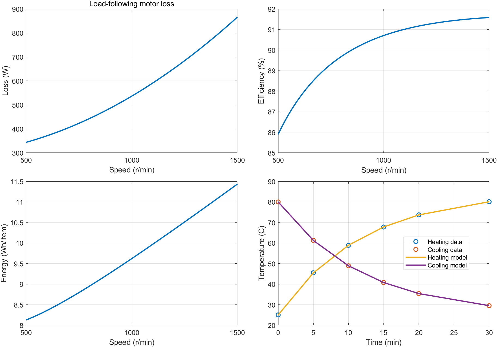
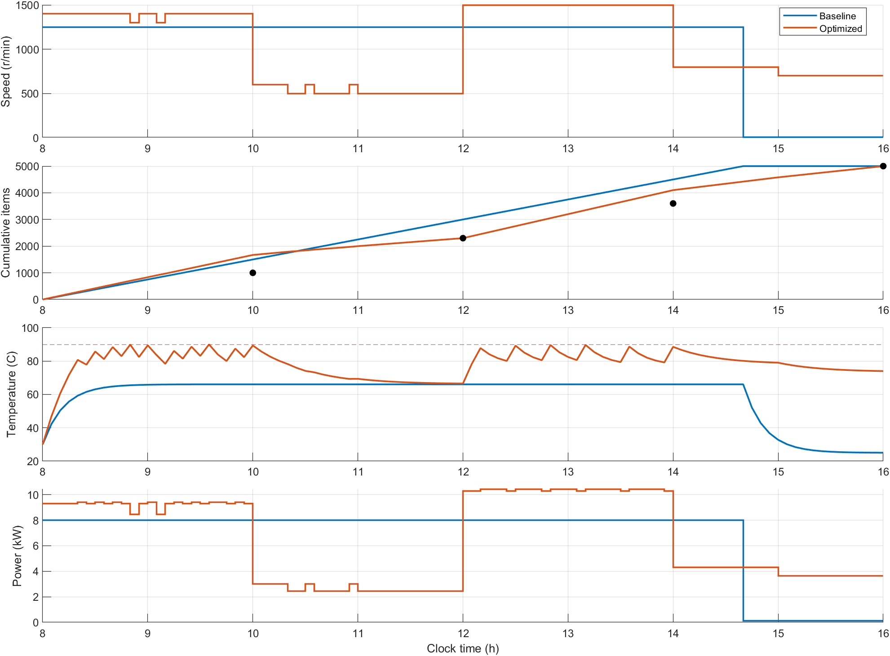
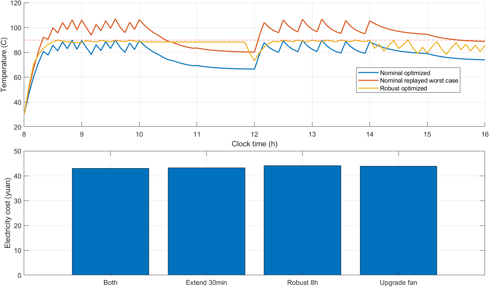

# 工业电机的能耗评估与生产运行优化

## 摘要

本文针对题设15 kW变频电机，建立二次损耗响应面、一阶集总参数热模型以及含温度约束的混合整数线性调度模型。使用 MATLAB R2024a 和 Optimization Toolbox 实际完成损耗最小二乘拟合、热参数联合辨识、基准方案评估、多情景调度和独立温度回放。所有试验数据为题设模拟数据，结论用于本题建模训练。

损耗模型训练RMSE为3.6056 W，留一交叉验证RMSE为7.2804 W；热模型联合拟合RMSE为0.0240 ℃。低速有利于降低单位产品电耗，但产能约束迫使电机提高转速。调度的主要价值在于将产量向较低电价时段转移，同时依据温度需要开启风机。本文严格区分电量节约、电费节约和最优性证明；求解器达到时间上限时，仅报告已验证可行解与最优间隙。

具体结果和逐段运行表见本报告末尾的“实际计算结果”以及 `results` 文件夹。运行 `run_motor_modeling` 可重新生成全部数值文件和图片。

## 1 问题分析与假设

1. 每个控制区间内转速、负载和风机状态恒定；忽略调速时间和能耗，遵循题设。
2. 生产率仅由转速决定，负载扰动不改变每转对应的加工件数。
3. 停机时电机损耗为零，允许风机继续工作；不另行增加题设未给出的变频器待机功率。
4. 单次启动电能0.03 kWh计入发生时段的电费，不计入绕组温升；没有将启动能耗虚构成瞬时功率。
5. 绕组用单一均匀温度表征；热阻、热容量在一个情景内不随温度变化。
6. 升级风机只改善开启状态的散热热阻，关闭状态的自然散热热阻维持原值；这是设备对比中补充的假设。
7. 班次开始前电机已停机足够长，不存在前一班次遗留的最短停机时长限制；风机可在08:00自由选择初始状态。
8. 题设连续转速范围经离散后求解。主要采用5 min控制间隔和100 r/min转速间隔，额外加入1250 r/min；另用50 r/min网格考察速度离散影响。计算结果是该控制网格上的可行近优方案，不能直接称为连续时间问题的精确全局最优。

关于第四问的交付口径：标准8小时方案仍在16:00交付全部订单；延时情景用于讨论新增500件允许16:30交付的情况，原有5000件应在16:00完成。若全部5500件都必须在16:00交付，则16:00之后的生产无法帮助满足该交期，不能据此声称延时具有交付收益。

## 2 符号与单位

| 符号 | 含义 | 单位 |
|---|---|---|
| \(n\) | 电机转速 | r/min |
| \(T_L\) | 负载转矩 | N·m |
| \(L\) | 电机损耗/进入热系统的功率 | W |
| \(P_{out},P_{in}\) | 轴端机械功率、电机输入功率 | W |
| \(\theta,\theta_a\) | 绕组温度、环境温度 | ℃ |
| \(R,C\) | 等效热阻、热容量 | K/W、J/K |
| \(u,f,s,d\) | 电机运行、风机开启、电机启动、电机停止指示 | 0或1 |
| \(Q\) | 累计产量 | 件 |
| \(p\) | 电价 | 元/kWh |

## 3 问题一：损耗、效率与单位产品电耗

### 3.1 二次响应面模型

对自变量进行量纲缩放，令 \(x=n/1000\)、\(y=T_L/60\)，拟合完整二次模型：

\[
L(n,T_L)=\beta_0+\beta_1x+\beta_2y+\beta_3x^2+\beta_4xy+\beta_5y^2.
\]

选择二次项是为了表达随速度、转矩增长的损耗及二者交互影响；它是经验响应面，不能将每个系数一一解释为单独的铁耗或铜耗。15组试验数据用于识别6个参数，使用 MATLAB `X\loss` 求线性最小二乘解，避免显式构造正规方程和求逆。

得到（损耗单位W）：

\[
\boxed{L=306-144x-170y+186.6666667x^2+172xy+268y^2.}
\]

训练RMSE为3.6056 W，最大相对拟合误差约1.89%，小于题设一般不超过3%的测量误差水平。留一交叉验证逐次删除一个观测点、重拟合剩余14点并预测被删除点，RMSE为7.2804 W。训练误差与留一误差分别表示拟合和小样本预测表现，不能用高决定系数代替预测验证。

适用范围为500≤n≤1500 r/min、30≤T_L≤90 N·m。题设工况及±10%转矩扰动均在该范围。整个试验矩形内模型损耗为正，且对转速、转矩的偏导为正；因此在本题工况范围内具有合理的单调性。不得据此外推到堵转、高于额定转速或温度相关损耗等工况。

### 3.2 能量指标

代入 \(T_L=30+0.02n\)：

\[
P_{out}(n)=\frac{2\pi n(30+0.02n)}{60},\quad
P_{in}(n)=P_{out}(n)+L(n,30+0.02n).
\]

\[
\eta(n)=\frac{P_{out}(n)}{P_{in}(n)},\qquad
e(n)=\frac{P_{in}(n)}{600n}\quad[\mathrm{kWh/件}].
\]

最后一个式子的分母包含 W→kW 与 min→h 的单位换算。风机电耗按独立设备另计；问题一的电机单位产品电耗不包含启动能耗与外置风机电耗。

在本题负载关系下，将模型展开后，\(P_{in}=a_0+a_1n+a_2n^2\)，其中a₀约288 W、a₂约0.00236817 W/(r/min)²。因此

\[
e'(n)=\frac{-a_0/n^2+a_2}{600}>0,\quad 500\le n\le1500.
\]

电耗最小值位于500 r/min，并非仅凭有限网格搜索作出的判断。该转速生产率只有5件/min，8小时只能生产2400件，无法满足5000件订单。设备经济运行点必须在生产约束下重新确定。

高速时电机效率虽然更高，但本题负载转矩也随转速提高，使每件产品所需机械功增加。因此，效率最高与单位产品电耗最低不是同一个目标；本题高速效率上升而单件电耗也上升，并不矛盾。

图1展示损耗、效率、单位产品电耗和热参数拟合结果。



## 4 问题二：热参数识别与连续运行能力

### 4.1 热平衡方程

采用一阶集总模型，时间t以秒计：

\[
C\frac{d\theta}{dt}=L-\frac{\theta-\theta_a}{R}.
\]

当损耗、环境温度和散热状态恒定时，解析解为：

\[
\theta(t)=\theta_a+RL+(\theta_0-\theta_a-RL)e^{-t/(RC)}.
\]

风机开启时用R，风机关闭时用2R；停机时令L=0，温度按相同方程继续下降。

同时拟合加热和冷却数据，构造12维温度残差向量，使用 MATLAB `lsqnonlin` 带正参数边界识别R、C。加热试验识别稳态温升与时间常数，冷却试验主要提供时间常数信息，联合使用能减少只拟合单一试验带来的参数不确定性。

\[
\boxed{R=0.060041390\ \mathrm{K/W},\quad C=12002.5005\ \mathrm{J/K}.}
\]

\[
\tau=RC=720.6467\ \mathrm{s}\approx12.0108\ \mathrm{min}.
\]

12个观测点的联合RMSE为0.024045 ℃。加热和冷却初始温度采用各自试验的25 ℃、80 ℃，没有混用正常班次的30 ℃初温。

### 4.2 安全连续运行与首次超温

定义平衡温度：

\[
\theta_\infty=\theta_a+RL.
\]

本题正常初温30 ℃低于90 ℃。若平衡温度≤90 ℃，则在恒定工况下一直不超过上限；若平衡温度>90 ℃，首次达到上限的时间为：

\[
t_{90}=-RC\ln\!\left(\frac{\theta_\infty-90}{\theta_\infty-30}\right).
\]

程序输出时间以min表示。若平衡温度恰为90 ℃，温度仅渐近趋近90 ℃，有限时间内不会触及；相应t₉₀记为Inf。

在25 ℃环境、题设负载下，风机开启时500～1500 r/min均可以连续运行8小时，也可以长期运行。1500 r/min下平衡温度约76.996 ℃。风机关闭时低速可长期运行，高速将超温；1500 r/min下从30 ℃升至90 ℃约需22.38 min。精确临界转速与代表性工况表见末尾数值结果。

## 5 问题三：生产调度优化

### 5.1 决策变量与精确温度离散

以5 min为一个控制区间，共96段。在速度集合\(\mathcal N\)中选择转速。令\(z_{kj}\)表示第k段选择第j个速度，\(u_k\)表示电机是否运行，则：

\[
\sum_jz_{kj}=u_k,\quad z_{kj},u_k\in\{0,1\}.
\]

\[
n_k=\sum_jn_jz_{kj},\quad L_k=\sum_jL_jz_{kj},\quad
Q_k=Q_{k-1}+0.01n_k\Delta t_{min}.
\]

给定风机状态f∈{0,1}，热递推为：

\[
\theta_{k+1}=a_f\theta_k+(1-a_f)(\theta_a+R_fL_k),\quad
a_f=e^{-60\Delta t_{min}/(R_fC)}.
\]

该式由解析解得到，不是显式欧拉近似。采用两组Big-M上下界约束，由风机二进制变量激活对应的一组递推。M=200 ℃足够覆盖本题有界温度和损耗对应的递推残差。

恒定工况下，一阶热系统在每一段内单调趋近平衡温度，因此段内最大值一定出现在某个端点。只要每段工况恒定，约束全部边界温度≤90 ℃即可保证整段不超温，不存在由采样遗漏区间内峰值的问题。

### 5.2 目标函数与约束

最小化全天电费：

\[
\min\sum_kp_k\left[\frac{\Delta t_{min}}{60000}
\left(\sum_jP_{in,j}z_{kj}+P_ff_k\right)+0.03s_k\right].
\]

\(s_k,d_k\)分别表示启动、停止事件：

\[
u_k-u_{k-1}=s_k-d_k,\quad s_k+d_k\le1,\quad u_0=0.
\]

最短10 min运行/停机限制用相邻两段实现：

\[
u_k+u_{k+1}\ge2s_k,\quad
(1-u_k)+(1-u_{k+1})\ge2d_k.
\]

禁止最后一段新启动，避免运行未满10 min。允许最后一段停止，符合题设班次结束后的停机时长豁免。风机每段5 min、仅在段边界切换，因此自动满足最短5 min开关时长。

同时满足10:00、12:00、14:00、16:00的累计交付下界，初温30 ℃，额定功率与转速范围限制。允许提前生产，没有强行将每个时点的产量锁定为交付下界。

固定速度集合后，所有损耗和功率都是预先计算的常数，目标和约束对决策变量均为线性。因此本问题是MILP，使用 `optimvar` / `optimproblem` 建模并调用 `intlinprog` 求解，而不采用无法提供最优间隙的遗传算法。

### 5.3 结果验证与解释

程序保留退出标志、求解器输出、最优相对间隙和最大约束违反量。每个方案再由独立数值回放重新计算温度、产量、启动次数与费用，并比较优化模型的目标值和温度状态。

求解器使用HiGHS，每个调度情景的时间上限为90 s。相对间隙使用 `output.relativegap`，其含义为(U−L)/|U|；报告以百分数展示。退出标志2表示提前停止但已找到整数可行点，并不表示已证明精确最优。参见[MathWorks intlinprog文档](https://www.mathworks.com/help/optim/ug/intlinprog.html)。

基准方案08:00—14:40以1250 r/min连续生产，14:40完成5000件后停止电机，风机持续运行到16:00。四个交付时点的产量为1500、3000、4500、5000件，全部满足要求。

经济调度一般表现为低价时段提高转速、高价时段降低转速；风机按照温度需要间歇开启。由于目标是电费最低，不能预先保证耗电量也最低。接近90 ℃的经济方案温度裕量很小，仅适合参数确定的理论计算；工程执行宜使用温度裕量或鲁棒方案。



## 6 问题四：不确定性与改造决策

### 6.1 情景定义

采用以下扰动：环境温度25～35 ℃；转矩因子0.9～1.1；最终订单5000或5500件。另设置损耗因子0.97～1.03，作为题设测量误差水平下的附加敏感性分析。该因子是建模假设，并不是由15个观测点推导出的统计置信区间。

分别考察环境温度升高、转矩增加、订单增加三种单因素情景。联合最坏情景取35 ℃、转矩增加10%、损耗增加3%、订单5500件；这时所有损耗评价仍落在原试验矩形范围内。

由于损耗在本题负载范围内随转矩单调增加，温度对损耗和环境温度均为正响应，一阶热系统保持序关系。因此，在热参数不变、生产率不因负载变化而改变的假设下，用上述最大环境温度、最大转矩和最大损耗制定的控制表，可以覆盖其下的整个参数盒。程序还在3×3×3=27个组合上独立回放验证，数值检查不能替代单调性论证。

### 6.2 自适应运行建议

将保守计划作为初始可行方案。每5 min采集绕组温度、累计产量、环境温度和负载估计；每30 min或在订单、负载显著变化时重新求解剩余班次计划，只执行第一个控制区间。

滚动模型必须继承当前温度、运行/停机状态以及尚未完成的最短持续时间，不能每次简单重置为停机初温。当前提供的程序完整实现离线多情景优化和回放；上述在线滚动控制属于可实施方案设计，未接入真实传感器或现场执行系统。

若要求更大的实际温度裕量，可以将cfg.tempLimit由90调整为88 ℃后重新求解。该2 ℃是工程预留值的示例，不是本次已经验证的热模型误差上界。

### 6.3 延时与风机升级的公平比较

所有改造情景均在联合最坏环境下生产5500件：

| 情景 | 原5000件交期 | 新增500件交期 | 风机功率 | 开启热阻 |
|---|---|---|---:|---:|
| 8小时原风机 | 16:00 | 16:00 | 120 W | R |
| 最多延时30 min | 16:00 | 16:30 | 120 W | R |
| 升级风机 | 16:00 | 16:00 | 200 W | 0.8R |
| 两项同时采用 | 16:00 | 16:30 | 200 W | 0.8R |

延时后的电价按0.90元/kWh处理，班次最长延长至16:30；优化可以选择提前停机，未强制必须加班满30 min。风机升级后的自然冷却热阻仍为2R。

比较的是电费、温度和可行产能，不包含风机购置费、人工加班费或设备折旧。因此“哪一种更有价值”须分开回答：有交期弹性时的电费收益，以及没有交期弹性时的散热能力收益。不能在缺少加班人工费和设备费用时计算投资回收期，也不能把不同交期的方案视为完全等价的服务承诺。



## 7 模型评价

优点是能量单位统一、热参数由两组试验共同识别、温度递推精确、启停逻辑显式可核验，同时能够报告整数规划的最优间隙。转速细网格的计算有助于判断速度离散造成的偏差。

局限包括单节点热模型忽略机壳与绕组的不同时间尺度；没有估计R、C的置信区间；忽略温度相关铜耗、加速过程和传动系统额外损耗；5 min网格限制了可选切换时刻；风机在90 ℃附近频繁切换虽然满足题设，但可能不适合实际设备寿命要求。启动次数已计算，但题设未给冲击成本，目标中没有虚构其金额。

若加入启停寿命成本、风机开关成本或总开关次数上限，应扩展目标或约束后重新求解，不能把本题电费最小解直接作为寿命最优解。

## 8 程序与结果文件

- `run_motor_modeling.m`：完整入口、内嵌数据、参数辨识、所有调度情景和图表输出。
- `verify_motor_results.m`：独立验算入口，包括ODE积分温度复核与交付检查。
- `results/results.mat`：结构化计算结果和求解器输出。
- `results/summary.csv`：各方案电量、电费、最高温度、产量、启动次数、可行性和最优间隙。
- `results/*_schedule.csv`：按连续相同工况合并的可执行时间表。
- `results/*_timeseries.csv`：每5 min的转速、风机、功率、温度和累计产量。
- `results/loss_fit.csv`、`thermal_fit.csv`：参数拟合残差。
- `results/continuous_operation.csv`：1 r/min网格的平衡温度与超温时间。
- `results/robust_validation_27.csv`：27种扰动组合回放。
- `results/*.png`、`*.fig`：报告图片及MATLAB可编辑图形。

运行方法：将MATLAB当前文件夹切换到本文件所在目录，在命令窗口执行：

```matlab
results = run_motor_modeling;
verification = verify_motor_results;
```

一次完整计算需要多次整数规划，运行时间与计算机性能有关。重新运行可能因时间上限而获得略有差异的可行解；MAT文件与日志保留本次实际计算结果。

<!-- NUMERICAL_RESULTS -->

## 9 实际计算结果

以下数值由本机MATLAB实际运行后写入，原始日志和MAT结果随文件提供。

### 9.1 总体指标

| 方案 | 电量/kWh | 电费/元 | 最高温度/℃ | 最终产量/件 | 启动次数 | 可行 | MILP间隙/% |
|---|---:|---:|---:|---:|---:|---|---:|
| 基准方案 | 53.5473 | 40.1815 | 66.0750 | 5000.0 | 1 | 是 | — |
| 名义调度100转网格 | 52.4066 | 34.2187 | 89.9982 | 5000.0 | 1 | 是 | 0.1492 |
| 细化调度50转网格 | 52.1756 | 34.1890 | 89.9470 | 5000.0 | 1 | 是 | 0.2115 |
| 名义方案在联合最坏条件回放 | 57.6333 | 37.6289 | 106.9520 | 5000.0 | 1 | 否 | — |
| 35℃单因素重优化 | 52.2956 | 34.2847 | 89.7127 | 5000.0 | 1 | 是 | 0.0222 |
| 负载增加10%重优化 | 57.4237 | 37.5696 | 89.9560 | 5000.0 | 1 | 是 | 0.2452 |
| 订单5500件重优化 | 58.5879 | 39.6111 | 89.9248 | 5500.0 | 1 | 是 | 0.0541 |
| 联合最坏鲁棒8小时 | 64.0937 | 44.0909 | 89.9650 | 5500.0 | 1 | 是 | 0.3152 |
| 鲁棒延时30分钟 | 63.2925 | 43.2071 | 89.9966 | 5500.0 | 1 | 是 | 0.8715 |
| 鲁棒升级风机 | 64.8313 | 43.8746 | 89.9868 | 5500.0 | 1 | 是 | 0.4204 |
| 鲁棒延时并升级风机 | 63.8586 | 43.0433 | 89.9933 | 5500.0 | 1 | 是 | 0.5544 |

相对基准，50 r/min细化方案节电2.562%、节费14.914%，每班节省5.9925元。它相对100 r/min方案的电费差为0.0297元，约为0.087%。该差异小于两个方案各自的最优间隙量级，不能全部归因为速度离散误差。

名义100 r/min方案的电费下界为34.167646元，上界为34.218699元。这个界限只针对该离散MILP，不是原连续控制问题的界限。

单因素重优化显示：环境升高10 ℃的电费增量约0.0660元；负载增加10%的电费增量约3.3509元；订单增加10%的电费增量约5.3924元。对应负载和订单的有限差分成本弹性约为0.979与1.576。在本题给定扰动幅度内，订单与负载对电费的影响明显大于环境温度；这些是有限情景对比，不能解释为任意工况下的局部导数。

### 9.2 代表性转速下的能效与温度

| 转速/(r/min) | 损耗/W | 电机效率/% | 单件电耗/Wh | 开风机平衡温度/℃ | 关风机平衡温度/℃ | 关风机首次90℃/min |
|---|---:|---:|---:|---:|---:|---:|
| 500 | 343.778 | 85.900 | 8.1272 | 45.641 | 66.282 | 永不达到 |
| 750 | 423.000 | 89.311 | 8.7940 | 50.398 | 75.795 | 永不达到 |
| 1000 | 536.444 | 90.707 | 9.6207 | 57.209 | 89.418 | 永不达到 |
| 1250 | 684.111 | 91.322 | 10.5115 | 66.075 | 107.150 | 36.123 |
| 1500 | 866.000 | 91.585 | 11.4342 | 76.996 | 128.992 | 22.381 |

风机关闭时的长期安全转速临界值为1009.2402 r/min；整数转速不高于1009 r/min时满足长期温度上限。

### 9.3 细化名义方案的分时段统计

下表是控制计划的统计，不可把平均转速当作已验证的恒定转速运行表；精确执行时间表见[fine_speed_grid_schedule.csv](results/fine_speed_grid_schedule.csv)。

| 时段 | 平均转速/(r/min) | 时段产量/件 | 累计产量/件 | 风机开启/min |
|---|---:|---:|---:|---:|
| 08:00—10:00 | 1366.667 | 1640.0 | 1640.0 | 50 |
| 10:00—12:00 | 550.000 | 660.0 | 2300.0 | 0 |
| 12:00—14:00 | 1500.000 | 1800.0 | 4100.0 | 85 |
| 14:00—16:00 | 750.000 | 900.0 | 5000.0 | 0 |

### 9.4 鲁棒验证与措施选择

联合最坏情景下原名义方案最高温度为106.952 ℃，且最终只有5000件，不能满足5500件订单。鲁棒计划在全部27个组合中通过交付和温度核验，27个场景的最高温度最大值为89.9650 ℃。

在追加500件允许16:30交付的前提下，延时方案电费为43.2071元；原时限升级风机方案电费为43.8746元；原风机8小时鲁棒方案电费为44.0909元。三者的生产量均为5500件。

用各自求解器上下界比较，而非只比较近似目标值：

| 鲁棒方案 | 电费下界/元 | 已验证方案电费/元 |
|---|---:|---:|
| 联合最坏鲁棒8小时 | 43.951956 | 44.090950 |
| 鲁棒延时30分钟 | 42.830591 | 43.207137 |
| 鲁棒升级风机 | 43.690159 | 43.874619 |
| 鲁棒延时并升级风机 | 42.804614 | 43.043256 |

延时方案的可行电费已低于升级方案的最优下界，在当前离散模型与交期口径下，延时的电费优势已得到界限支持。

若所有5500件必须在16:00交付，则不能把上述延时方案的较低电费作为同交期条件下的比较结论。实际经济选择还需扣除新增人工费和风机购置维护费。

### 9.5 独立复核

独立复核采用高精度ode45逐段积分一阶微分方程，比较解析热递推；同时重新检查交付、原5000件在16:00前完成、最短启停时间和启动次数。结果记录在[independent_verification.csv](results/independent_verification.csv)。

名义细化方案、鲁棒方案及其改造方案的完整控制表均在results文件夹，以对应的_schedule.csv为准。
